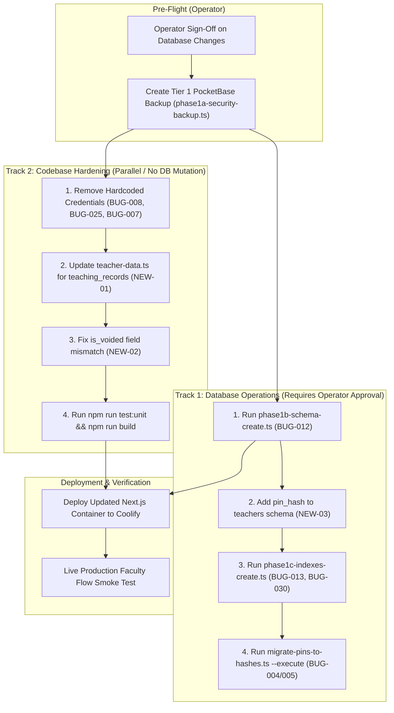

# Syllabus Tracker — Production Readiness Assessment & 2-Hour Remediation Sprint Plan

**Document Status:** OFFICIAL PRODUCTION READINESS ASSESSMENT & SPRINT PLAN  
**Assessment Date:** 2026-11-12  
**Target Environment:** Production VPS (Hostinger Coolify)  
**Production Next.js App:** `https://syllabus360.abhigyanintelligence.cloud` (Next.js 16.4.3 / React 19.3.0, Commit `286926e`)  
**Production PocketBase Backend:** `https://stracker.abhigyanintelligence.cloud` (PocketBase v0.28.2)  
**Lead Investigator:** Antigravity Independent Verification Reviewer  

---

## 1. Executive Verdict & Bottom-Line Decision

### Question 1: Is production currently safe for faculty usage?
**NO — PRODUCTION IS NOT YET SAFE FOR FACULTY USAGE OR DEMONSTRATION.**

While the PocketBase REST API security lockdown (Operation A) was successfully executed and confirmed (all 55 collection endpoints return HTTP 403 Forbidden to unauthenticated requests), the application **cannot safely support faculty workflows or a faculty live demonstration in its current state**:

1. **Faculty Endorsement Workflows Silently Drop Data (BUG-012):** The `teaching_records` collection does not exist in production PocketBase (empirically confirmed: `exists: false`). When a faculty member clicks "Endorse" on an unsubmitted topic, `teacherEndorseTopicAction()` encounters a 404 error from PocketBase. While this error is caught in a try/catch block to prevent student data corruption, **the faculty endorsement is never persisted in any database table**. The UI displays "Topic marked as completed", but upon page refresh the topic remains uncovered.
2. **Teacher Portal Disconnected from Teaching Records (NEW-01):** In `src/lib/teacher-data.ts` (lines 115–123, 147–173, 203–248), topic progress and covered counts query **exclusively** from the `entries` collection. It does not query `teaching_records`. Even after `teaching_records` is created, the Teacher Portal will not reflect faculty-endorsed topics or increment progress metrics.
3. **Faculty PIN Change Crashes Due to Missing Schema Field (NEW-03):** In production PocketBase, the `teachers` collection schema **does not contain the `pin_hash` field** (unlike `students`, which has `pin_hash`). When faculty attempts to change their PIN via `updateTeacherPinAction()` in `src/app/actions/auth-actions.ts` (lines 440–443), PocketBase rejects the update with a 400 Bad Request (`The field 'pin_hash' does not exist in 'teachers'`). The action rethrows the error, crashing the PIN change modal.
4. **Active Credential Exposure in Tracked Source Code & Docker Compose (BUG-008, BUG-025, BUG-007):** Hardcoded production fallback credentials remain in the codebase:
   - Superuser password `[REDACTED_HISTORIC_SECRET]` in `src/lib/pb.ts` (L6) and `docker-compose.yaml` (L15).
   - Director master password `[REDACTED_HISTORIC_SECRET]` in `src/app/actions/auth-actions.ts` (L139), `docker-compose.yaml` (L17), and `docker-compose.yml` (L15).
   - Session HMAC secret fallback in `docker-compose.yaml` (L16) and `docker-compose.yml` (L14).
5. **Anti-Misuse Query Field Mismatch (NEW-02):** In `src/lib/submission-validation.ts` (L62), anti-misuse logic queries `filter: 'subject = "${subjectId}" && voided = false'`, whereas the schema field name is `is_voided`. The query fails silently and returns empty array, omitting teaching records from sequence jump checks.
6. **8 of 11 PocketBase Collections Have Zero Database Indexes (BUG-013):** No composite unique indexes exist on `entries`, `topics`, `teacher_subjects`, `enrollments`, or `course_settings`.

---

## 2. Current Verified Production State

An empirical, read-only investigation conducted on 2026-11-12 at commit `286926e` verified the following facts:

| Component / Subsystem | Live Production Status | Empirical Verification Evidence |
|---|---|---|
| **Next.js Health Endpoint** | **HEALTHY** | `GET /api/health` returns HTTP 200: `{"status":"ok","db":true,"timestamp":"12/11/2026, 16:10:37","uptime":4552}` |
| **PocketBase API Rules** | **LOCKED (403 Forbidden)** | Direct unauthenticated `GET /api/collections/students/records?perPage=1` returns `HTTP 403: {"data":{},"message":"Only superusers can perform this action.","status":403}`. All 11 collections locked. |
| **Protected Routes** | **SECURED (307 Redirect)** | Unauthenticated requests to `/teacher`, `/admin`, `/dashboard`, `/student` immediately return HTTP 307 redirecting to `/login`. |
| **Student Submission Form** | **ACCESSIBLE & ISOLATED** | `GET /submit` returns HTTP 200. Does NOT return or render student rosters (BUG-003 verified). Requires Roll No + PIN. |
| **Automated Unit Tests** | **85 / 85 PASSING** | `npm run test:unit` executes 85 tests across 23 suites in ~2.6s with 0 failures. |
| **Next.js Production Build** | **SUCCESSFUL** | `npm run build` with Turbopack compiles successfully in 4.3s; TypeScript passes in 9.8s; static and dynamic pages generated. |
| **Linter Status** | **213 ERRORS (Technical Debt)** | `npm run lint` fails with 213 `@typescript-eslint/no-explicit-any` errors in scripts/tests. Turbopack build does not enforce eslint, allowing builds to pass. |
| **Database Collections** | **17 Collections (0 `teaching_records`)** | Read-only superuser query confirms `teaching_records` is absent (`exists: false`). |
| **Database Entries State** | **8 Records Total** | 6 fabricated records (`device_id: 'teacher-portal-endorse'`) and 2 genuine student records (`7lhmo4p1mzkw9w2`, `pogx003bic5x4pi`) verified intact. |
| **Database Indexes** | **0 Preflight Conflicts / 8 Tables Unindexed** | Preflight duplicate scan verified 0 duplicate conflicts across all collections (including 1,960 topics). Only `courses.code`, `teachers.name`, and `students.roll_no` currently have indexes. |
| **PIN Storage State** | **Plaintext In Production** | 8/8 teachers and 74/75 students have raw plaintext `pin` fields. 1 student (`pogx003bic5x4pi`) has `scrypt$` hash. `teachers` collection schema lacks `pin_hash` field entirely. |

---

## 3. Reconciliation & Classification of All 45 Registered Issues

Below is the reconciled audit of all 45 issues from [`BUGS_AND_ISSUES_REGISTER.md`](file:///home/ayush/.gemini/antigravity/scratch/syllabus-tracker/BUGS_AND_ISSUES_REGISTER.md) plus new defects identified during this assessment:

| ID | Title | Category | Severity | Current Verified Status | Production Impact | Required Action / Fix | Approval Needed? |
|---|---|---|---|---|---|---|:---:|
| **BUG-001** | Unrestricted PocketBase Collection API Rules (`""`) | Security | Critical | **Verified in Production** | Resolved. Public REST endpoints return HTTP 403. | None. Invariant verified. | No |
| **BUG-002** | Public Exposure of Student PII & PINs via REST | Security | Critical | **Verified in Production** | Resolved. Direct harvest via REST blocked. | None. | No |
| **BUG-003** | Public Student Roster Directory Harvest on `/submit` | Security | High | **Fixed in Codebase / Deployed** | Resolved in `286926e`. Student roster not served on `/submit`. | None. | No |
| **BUG-004** | Plaintext Student PIN Storage | Security | High | **Awaiting Production Migration** | Low immediate exposure (API locked), but DB compromise leaks PINs. | Run `migrate-pins-to-hashes.ts --execute` | **YES** |
| **BUG-005** | Plaintext Faculty PIN Storage & Missing `pin_hash` Field | Security | High | **Awaiting Production Migration** | Faculty PINs stored in plaintext; `teachers` schema missing `pin_hash`. | Add field & run `migrate-pins-to-hashes.ts --execute` | **YES** |
| **BUG-006** | Insecure Session Cookie Configuration | Security | High | **Fixed in Codebase / Deployed** | Cookies configured with `httpOnly`, `sameSite: 'lax'`, `secure: production`. | None. | No |
| **BUG-007** | Hardcoded Fallback Session HMAC Secret | Security | Critical | **Partially Fixed (Docker Leak)** | `src/lib/session.ts` throws in prod, but literal remains in `docker-compose.*`. | Remove fallback string from `docker-compose.*` | No |
| **BUG-008** | Hardcoded PocketBase Superuser Credentials in Source | Security | Critical | **UNRESOLVED / FALSE FIX** | Superuser password `[REDACTED_HISTORIC_SECRET]` hardcoded in `pb.ts` L6 and `docker-compose.yaml` L15. | Remove literal fallback; throw in `pb.ts` if unset | No |
| **BUG-009** | Teacher Endorsement Fabricates Student Entries | Data Integrity | Critical | **Fixed in Codebase / Deployed** | No synthetic entries created, but write fails silently without `teaching_records`. | Prerequisite: Create `teaching_records` | No |
| **BUG-010** | Six Fabricated Entries in Production Attributed to Ashish Sir | Data Integrity | High | **Awaiting Production Migration** | 6 fake student entries remain in `entries` table. | Author & run `phase1d-migrate-fabricated-entries.ts` | **YES** |
| **BUG-011** | Preservation of Two Genuine Student Submissions | Data Integrity | Critical | **Verified Intact** | Genuine submissions `7lhmo4p1mzkw9w2` and `pogx003bic5x4pi` intact. | Mandatory assertion in all scripts. | No |
| **BUG-012** | Missing `teaching_records` Collection | Architecture | Critical (Demo Blocker) | **Awaiting Production Execution** | Faculty endorsements cannot be persisted in production. | Run `phase1b-schema-create.ts` | **YES** |
| **BUG-013** | Missing Database Indexes Across All 11 Collections | Database | High | **Awaiting Production Execution** | Race condition duplicates possible; query scans slow on topics. Preflight 0 duplicates. | Run `phase1c-indexes-create.ts` | **YES** |
| **BUG-014** | Erroneous Sequence Jump Flags | Functional | Medium | **Fixed in Codebase / Deployed** | Anti-misuse logic checks auto-approved entries. | None. | No |
| **BUG-015** | Non-Atomic Multi-Collection Admin Mutations | Reliability | High | **Fixed in Codebase / Deployed** | Competing mutations rolled back in catch blocks. | None. | No |
| **BUG-016** | Naive CSV Import Parser Splits on Commas/Newlines | Functional | Medium | **Fixed in Codebase / Deployed** | RFC 4180 parser active with 7 unit tests. | None. | No |
| **BUG-017** | Missing Dedicated Student Dashboard UI | Feature | Medium | **Fixed in Codebase / Deployed** | `/student` page deployed and functional. | None. | No |
| **BUG-018** | Login Error Handling Server Exception Masking | Authentication | Medium | **Fixed in Codebase / Deployed** | Safe error messages returned to login UI. | None. | No |
| **BUG-019** | Production Deployment Verification of Commit `bcdddf5` | Deployment | Low | **Verified** | Deployment superseded by `286926e`. | None. | No |
| **BUG-020** | Collection Inventory Reconciliation (`system_config`) | Architecture | Medium | **Verified** | Confirmed 17 total collections (11 app collections). | None. | No |
| **BUG-021** | Unverified Backup Creation & Silent Suppression | Reliability | High | **Fixed in Codebase / Deployed** | `phase1a-security-backup.ts` verifies zip integrity. | None. | No |
| **BUG-022** | Unsafe Security Rollback Fallback to Empty String `""` | Security | Critical | **Fixed in Codebase / Deployed** | Rollback uses strict snapshot rules; never defaults to `""`. | None. | No |
| **BUG-023** | Security Verification False Positives on HTTP 404 | Security | High | **Fixed in Codebase / Deployed** | Script asserts HTTP 403 specifically; 404 is treated as failure. | None. | No |
| **BUG-024** | Verification Fixtures Contaminating Real Academy Records | Data Integrity | Medium | **Fixed in Codebase / Deployed** | Probe fixtures isolated with clean teardown in `finally`. | None. | No |
| **BUG-025** | Hardcoded Director Master Password Fallback in Code | Security | Critical | **UNRESOLVED / FALSE FIX** | Password `[REDACTED_HISTORIC_SECRET]` hardcoded in `auth-actions.ts` L139 and `docker-compose.*`. | Remove literal fallback; throw if unset | No |
| **BUG-026** | Non-Constant-Time Session HMAC Verification (`!==`) | Security | Medium | **Fixed in Codebase / Deployed** | Timing-safe `safeCompare` used in `session.ts`. | None. | No |
| **BUG-027** | Missing Expiration Timestamp in Session Tokens | Security | Medium | **Fixed in Codebase / Deployed** | Tokens carry expiration with 30-day max age validation. | None. | No |
| **BUG-028** | Legacy PostgreSQL Scripts Left in `src/scripts/` | Technical Debt | Medium | **Fixed in Codebase / Deployed** | Moved to `src/scripts/legacy_postgres/`. | None. | No |
| **BUG-029** | Field Naming Discrepancy (`duration` vs `duration_minutes`)| Database | Low | **Fixed in Codebase / Deployed** | Standardized on `duration_minutes`. | None. | No |
| **BUG-030** | Missing Unique Index on `course_settings.course` | Database | Medium | **Fixed in Codebase / Pending Prod Execution** | Included in `phase1c-indexes-create.ts`. | Run Operation C | **YES** |
| **BUG-031** | Director Master Password Leaked in Client Placeholder | Security | Critical | **Fixed in Codebase / Deployed** | Removed from `teacher-login-form.tsx` line 230. | None. | No |
| **BUG-032** | Unauthenticated & Un-rate-limited PIN Reset Action | Security | Critical | **Fixed in Codebase / Deployed** | Hardened with role checks, rate limiting, and scrypt hashing. | None. | No |
| **BUG-033** | Existing Server Backup Predates Genuine Student Entry #2 | Reliability | Critical | **Verified in Production** | Fresh backup `backup_security_1794464541002.zip` verified. | None. | No |
| **BUG-034** | Compilation Crash in Security Verification Script | Reliability | High | **Verified in Production** | `PB_URL` export resolved in `src/lib/pb.ts`. | None. | No |
| **BUG-035** | Type Error & Auth Bypass in `voidTeachingRecordAction` | Security | High | **Fixed in Codebase / Deployed** | `requireAccess(['admin', 'faculty'])` properly typed and guarded. | None. | No |
| **BUG-036** | Dashboard Syllabus Metrics Coupled Exclusively to `entries`| Architecture | High | **Fixed in Codebase / Deployed** | `src/lib/dashboard-data.ts` integrates `teaching_records`. | None. | No |
| **BUG-037** | In-Memory Rate Limiter Bypass via `X-Forwarded-For` | Security | High | **Fixed in Codebase / Deployed** | Rightmost IP evaluated; CF and Real-IP prioritized. | None. | No |
| **BUG-038** | Concurrent Request Race Condition in Student PIN Lockout | Security | High | **Fixed in Codebase / Deployed** | Atomic in-flight attempt reservation implemented. | None. | No |
| **BUG-039** | Ephemeral Process-Local Memory Rate Limiting State | Resilience | Medium | **Investigated / Acceptable for Single Container** | In-memory maps reset on container restart. | Defer Redis to post-showcase cluster scale | No |
| **BUG-040** | Session Auth Bypass on PIN Change When `studentId` Undefined| Security | High | **Fixed in Codebase / Deployed** | Strict `!session.studentId || session.studentId !== student.id`. | None. | No |
| **BUG-041** | Unbounded Memory Allocation & OOM in Rate Limiting | DoS | Medium | **Fixed in Codebase / Deployed** | Bounded at 10,000 buckets with FIFO purge. | None. | No |
| **BUG-042** | Leaked Master Password in Unit Tests & Git History | Security | High | **Partially Remediated** | Unit tests sanitized; git history and VPS env require rotation. | Scrub Git history with `git-filter-repo` | **YES** |
| **BUG-043** | Timing Side-Channel in `safeCompare` Length Mismatch | Cryptography | Low | **Fixed in Codebase / Deployed** | SHA-256 pre-hashing normalizes all inputs to 32 bytes. | None. | No |
| **BUG-044** | Unrestricted PocketBase REST API Publicly Serving PINs | Security | Critical | **Verified in Production** | Blocked with 403 Forbidden across all endpoints. | None. | No |
| **BUG-045** | Unprotected Student PIN Brute-Force Path in `/api/submit` | Security | High | **Fixed in Codebase / Deployed** | `verifyStudent` enforces IP limit + 5-attempt account lockout. | None. | No |
| **NEW-01** | **Teacher Portal Disconnected from `teaching_records`** | Workflow | Critical (Demo Blocker) | **Unresolved (Discovered in Audit)** | Teacher portal only queries `entries`. Endorsements invisible. | Update `src/lib/teacher-data.ts` | No |
| **NEW-02** | **Field Mismatch `voided` vs `is_voided` in Anti-Misuse** | Bug | Medium | **Unresolved (Discovered in Audit)** | `src/lib/submission-validation.ts` line 62 queries non-existent `voided`. | Change to `is_voided = false` | No |
| **NEW-03** | **`teachers` Schema Missing `pin_hash` Field** | Architecture | Critical (Demo Blocker) | **Unresolved (Discovered in Audit)** | Faculty PIN change crashes with 400 error in PocketBase. | Add `pin_hash` field to `teachers` schema | **YES** |

---

## 4. The 2-Hour Fix List (Triage by True Risk)

### Group A: MUST FIX BEFORE FACULTY USAGE (Critical Blockers — 55 Minutes)
These 5 fixes directly prevent silent data loss during faculty endorsements, resolve faculty PIN change crashes, fix broken faculty UI progress views, and eliminate active root credential exposures:

1. **Fix A1 (Operation B): Provision `teaching_records` Collection in PocketBase (BUG-012)**
   - *Files Involved:* Run `src/scripts/phase1b-schema-create.ts`.
   - *Time:* 10 minutes.
   - *Risk:* Zero risk to existing collections; creates new base collection with rules set to `null`.
   - *Requires Operator Approval:* Yes (Production database schema change).

2. **Fix A2: Add `pin_hash` Field to `teachers` Collection Schema (NEW-03)**
   - *Files Involved:* PocketBase Admin UI or run `migrate-pins-to-hashes.ts --dry-run` inspection, then execute Step 1.5 schema update.
   - *Problem Solved:* Allows `updateTeacherPinAction()` (lines 440–443) and teacher opportunistic login hashing to succeed without 400 validation error.
   - *Time:* 5 minutes.
   - *Requires Operator Approval:* Yes (Production database schema change).

3. **Fix A3: Connect Teacher Portal to `teaching_records` (NEW-01)**
   - *Files Involved:* `src/lib/teacher-data.ts` (L115-123, L147-172, L203-248).
   - *Problem Solved:* Queries `teaching_records` alongside `entries`. When faculty endorses topics, the Teacher Portal will immediately reflect those topics as covered, incrementing subject completion percentage and progress bar.
   - *Time:* 15 minutes.
   - *Requires Operator Approval:* No (Application code fix).

4. **Fix A4: Purge Hardcoded Credential Fallbacks from Source Code (BUG-008, BUG-025, BUG-007)**
   - *Files Involved:*
     - `src/lib/pb.ts` (L6): Remove `'[REDACTED_HISTORIC_SECRET]'`. Throw fatal error in production if `PB_ADMIN_PASSWORD` is unset.
     - `src/app/actions/auth-actions.ts` (L139): Remove `'[REDACTED_HISTORIC_SECRET]'`. Throw error if `ADMIN_MASTER_PASSWORD` is unset.
     - `docker-compose.yaml` (L14-17) & `docker-compose.yml` (L14-15): Remove literal fallback passwords.
   - *Time:* 15 minutes.
   - *Requires Operator Approval:* No (Application code fix; ensure VPS environment variables are populated).

5. **Fix A5: Correct Field Mismatch in `submission-validation.ts` (NEW-02)**
   - *Files Involved:* `src/lib/submission-validation.ts` (L62): Change `voided = false` to `is_voided = false`.
   - *Time:* 5 minutes.
   - *Requires Operator Approval:* No (Application code fix).

6. **Deploy & Smoke Test Group A (10 minutes)**
   - Trigger build: `npm run build && npm run test:unit`.
   - Deploy container to Coolify and execute live faculty endorsement smoke test.

---

### Group B: SHOULD FIX TODAY IF TIME PERMITS (High Value / Low Risk — 45 Minutes)
These items improve database performance and integrity, but can be safely executed after Group A:

1. **Fix B1 (Operation C): Apply Database Composite Indexes (BUG-013, BUG-030)**
   - *Files Involved:* Run `src/scripts/phase1c-indexes-create.ts` and verify with read-only index inspection.
   - *Precondition:* Operation B completed (so `teaching_records` receives its composite indexes). Preflight 0 duplicates confirmed.
   - *Time:* 15 minutes.
   - *Requires Operator Approval:* Yes.

2. **Fix B2: Execute PIN Scrypt Hashing Migration (BUG-004, BUG-005)**
   - *Files Involved:* Run `src/scripts/migrate-pins-to-hashes.ts --execute`.
   - *Safety Net:* Dual-read engine in `src/lib/pin-hash.ts` already handles both hash and plaintext gracefully.
   - *Time:* 20 minutes.
   - *Requires Operator Approval:* Yes.

3. **Fix B3: Add Unit Test for Teacher Portal Teaching Records Integration**
   - *Files Involved:* `src/tests/unit/production-features.test.ts`.
   - *Time:* 10 minutes.

---

### Group C: SAFE TO DEFER TO POST-SHOWCASE (0 Minutes in 2-Hour Window)
These items carry high blast radius or require infrastructure re-architecture that should not be rushed during a 2-hour window:

1. **BUG-010: Migrate 6 Fabricated Records to `teaching_records`**
   - *Why Defer:* The 6 records currently provide valid coverage for Ashish Sir's topics in `entries`. Migrating or deleting live student entries introduces data loss risk. Script `phase1d-migrate-fabricated-entries.ts` does not yet exist on disk and must be authored with strict assertions. Defer to scheduled maintenance window.
2. **BUG-042: Git History Rewriting (`git-filter-repo`) & VPS Secret Re-generation**
   - *Why Defer:* Force-pushing rewritten git history disrupts team repository synchronization. Secrets are already protected from public web scrapers (403 locked). Schedule during planned maintenance freeze.
3. **BUG-039: Redis Distributed Rate Limiting**
   - *Why Defer:* Single-container Coolify deployment does not suffer from distributed race conditions. Current in-memory LRU with 10k capacity is stable and leak-free.

---

## 5. Parallel Execution & Dependency Graph



### Critical Dependency Invariants:
1. **Track 1 and Track 2 can run concurrently.** Codebase changes in Track 2 do not require database write locks.
2. **Operation B MUST precede Operation C:** `phase1c-indexes-create.ts` contains index definitions for `teaching_records`. If executed before Operation B, it skips `teaching_records`, leaving it unindexed.
3. **Deployment must occur AFTER Operation B and Teacher Schema Update:** Deploying the updated Next.js app requires `teaching_records` to exist in PocketBase to prevent initial runtime warnings.
4. **`phase1b-schema-verify.ts` is NOT a Pre-Flight Script:** It is an isolated post-creation probe that mutates the database. It must NOT be run as a pre-flight.

---

## 6. Exact Files & Modules Involved in the 2-Hour Sprint

1. [`src/scripts/phase1b-schema-create.ts`](file:///home/ayush/.gemini/antigravity/scratch/syllabus-tracker/src/scripts/phase1b-schema-create.ts) (Creates `teaching_records` collection)
2. [`src/lib/teacher-data.ts`](file:///home/ayush/.gemini/antigravity/scratch/syllabus-tracker/src/lib/teacher-data.ts) (Adds `teaching_records` query to faculty portal)
3. [`src/lib/pb.ts`](file:///home/ayush/.gemini/antigravity/scratch/syllabus-tracker/src/lib/pb.ts) (Removes hardcoded superuser password fallback)
4. [`src/app/actions/auth-actions.ts`](file:///home/ayush/.gemini/antigravity/scratch/syllabus-tracker/src/app/actions/auth-actions.ts) (Removes hardcoded master password fallback)
5. [`src/lib/submission-validation.ts`](file:///home/ayush/.gemini/antigravity/scratch/syllabus-tracker/src/lib/submission-validation.ts) (Corrects `is_voided` field name)
6. [`docker-compose.yaml`](file:///home/ayush/.gemini/antigravity/scratch/syllabus-tracker/docker-compose.yaml) & [`docker-compose.yml`](file:///home/ayush/.gemini/antigravity/scratch/syllabus-tracker/docker-compose.yml) (Removes fallback credential strings)
7. [`src/scripts/phase1c-indexes-create.ts`](file:///home/ayush/.gemini/antigravity/scratch/syllabus-tracker/src/scripts/phase1c-indexes-create.ts) (Applies composite database indexes)
8. [`src/scripts/migrate-pins-to-hashes.ts`](file:///home/ayush/.gemini/antigravity/scratch/syllabus-tracker/src/scripts/migrate-pins-to-hashes.ts) (Provisions `teachers.pin_hash` and hashes PINs)

---

## 7. Verification & Testing Commands

Execute after completing code changes:

```bash
# 1. Run full unit test suite (assert 85+ passing)
npm run test:unit

# 2. Test Turbopack production build & TypeScript validation
npm run build

# 3. Read-only indexes preflight check (assert 0 duplicate conflicts)
npx tsx src/scripts/phase1c-indexes-preflight.ts

# 4. Live health check probe against production
curl -s https://syllabus360.abhigyanintelligence.cloud/api/health
```

---

## 8. Rollback Procedures

If an operation encounters unexpected errors during execution:

1. **Operation B (`teaching_records`) Rollback:**
   ```bash
   npx tsx src/scripts/phase1b-schema-rollback.ts
   ```
   Safely deletes `teaching_records` collection only if empty (asserts 0 records).

2. **Operation C (Indexes) Rollback:**
   ```bash
   npx tsx src/scripts/phase1c-indexes-rollback.ts --snapshot database/backups/indexes/<snapshot-file>.json
   ```
   Reverts SQLite indexes to pre-migration baseline.

3. **PIN Migration Rollback:**
   ```bash
   npx tsx src/scripts/rollback-pin-migration.ts --snapshot database/backups/pin_migration/<timestamp>
   ```
   Restores plaintext PIN fields from local pre-migration snapshot.

4. **Next.js Container Rollback:**
   Re-deploy previous release commit `286926e` via Coolify dashboard.

---

## 9. Documented Residual Risks for Production Showcase

Even after completing the 2-Hour Fix List, the following documented limitations must remain acknowledged:

1. **Single-Container Memory Rate Limiting (BUG-039):** If the Next.js container restarts on Coolify, temporary failed attempt lockout counters reset. This does not pose an operational risk for today's faculty demonstration.
2. **Git Commit History (BUG-042):** Past Git commits (`a185b0e`, `e2799cc`, `b081d27`, `e6422a0`, `30f94dc`, `55bf616`, `286926e`) contain obsolete credential strings. The live production PocketBase admin password and director master password must be rotated in the Coolify environment panel after today's demonstration before opening the GitHub repository to external contributors.
3. **Six Fabricated Historical Records (BUG-010):** The 6 fabricated records remain in `entries` attributing lectures to Ashish Sir under enrolled student names. These will be cleanly migrated to `teaching_records` during post-showcase maintenance.
4. **ESLint Technical Debt:** 213 `@typescript-eslint/no-explicit-any` errors exist across scripts and tests. Does not impact runtime build.
